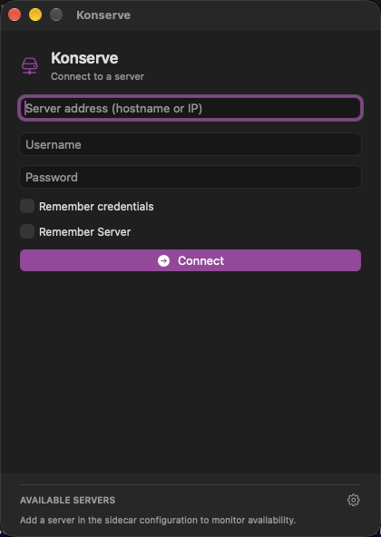

# Konserve

Konserve is a small native macOS app for connecting to SMB servers and mounting
their shares.



## Features

- Connect to an SMB server by hostname or IP address.
- Discover available shares and mount selected shares in Finder.
- Store remembered credentials in the macOS Keychain, never in the server configuration.
- Monitor configured servers and try fallback endpoints in order.
- Deploy a shared JSON configuration to preconfigure client installations.

## Requirements

- macOS 13 or later
- Xcode 15 or later

## Build and test

Open [`Konserve.xcodeproj`](./Konserve.xcodeproj) in Xcode, or run:

```bash
./scripts/dev-build.sh
./scripts/test.sh
```

Run the app locally with:

```bash
./scripts/dev-run.sh
```

Server definitions are stored in the shared system location
`/Users/Shared/Konserve/servers.json`. The location can be changed from the
server settings window.

More development and testing notes are available in [`docs/`](./docs/).
